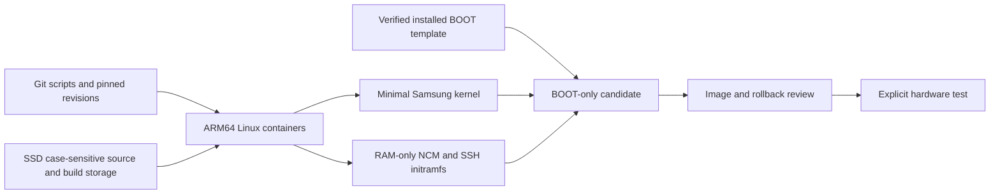

# Architecture

## Host and build boundary

Apple M4 macOS -> Docker ARM64 Linux -> pinned Samsung kernel source -> ignored build outputs. A Debian container provides clang/LLVM, host build tools and packaging dependencies. Source/configuration/provenance live in Git; upstream checkouts, images and logs stay outside tracked content. The case-sensitive SSD source tree is mounted read-only; configuration and build outputs use separate writable directories on the same SSD build image. The macOS source checkout has filename case collisions and serves only as a Git-object seed, never as the compiler input.

The running ROM used Android clang r563880c / LLVM 21. The initial native ARM64 builder uses Debian LLVM 19 to test compatibility without x86 emulation. This is source/configuration reproduction with a different compiler, not a byte-identical ROM reproduction. Compiler incompatibilities must be documented rather than silently changing the kernel.

## Device boot boundary

Existing Samsung signed firmware/bootloader -> unlocked OS-image policy -> Android boot header v2 with kernel, ramdisk and device trees -> Linux initramfs. Keep the existing bootloader and recovery route. Known release packaging includes patched top-level vbmeta; recovery has its own AVB footer. DTBO, AVB flags, partition sizes and rollback policy are independent constraints.

The first native experiment should target a small initramfs and USB NCM/SSH. Do not depend on decrypted Android userdata. Do not assume A/B slots, fastboot temporary boot, or firmware support for external boot media.

## Desktop boundary

Display/KMS, input and GPU acceleration are separate subsystems. The downstream msm_drm display nodes and Adreno KGSL interface are present under Android; a DRM render node alone does not establish Mesa support. The patched Zink/Turnip stack now drives accelerated Hyprland and Omarchy mobile from a read-only Arch RAM image. Touch/S Pen, Squeekboard, manual NetworkManager and a fixed PipeWire built-in-audio profile are validated. BusyBox remains PID 1; this is a native mobile prototype rather than a supported full Omarchy/systemd installation.

## Evidence and recovery

Build success, image structural validity and real-device functionality are separate milestones. Every output should record source revision, configuration hash, compiler, build command and artifact hashes. Native hardware support is marked complete only after testing. Installed recovery, Download Mode policy state and restoration artifacts must be established before any partition experiment.

## Current artifact flow

The initramfs uses a RAM log, USB-local DHCP and key-only SSH. No Android filesystem is mounted. Kernel 4.14 compatibility with a future complete Arch/systemd/Omarchy stack remains a separate gate; the minimal experiment does not establish it.

## Verified graphics path (step 8)

Hardware compute, offscreen graphics readback, GBM export/scanout handles and visible continuously animated Wayland output are verified. Two scoped userspace patches bridge duplicate downstream plane formats (Weston) and the separate KGSL/SDE identities (Zink). A bounded legacy modeset releases Samsung's splash-plane reservation before Weston starts. All runtime data lives in RAM, and the original Android BOOT is restored after testing. Details, pins and limitations: docs/graphics-bringup.md.

Step 9 hardware checkpoint (2026-11-15): read-only Arch SquashFS in RAM, non-root GPU readback and bounded Hyprland passed using an isolated libudev 257 prefix. Android restored and all four original partition hashes verified. Omarchy integration and service compatibility remain open; see docs/arch-userspace.md and docs/build-records/hardware-test-06.json.

Omarchy shell integration uses a separate RAM image, an isolated libudev compatibility prefix and a parent-side Qt forkfd bootstrap before loading the unchanged upstream host. Seatd and a private D-Bus session are launched directly. Current systemd is not PID 1. The owner authorizes keeping native Linux testing mode active between experiments; see docs/omarchy-shell.md.

Current mobile profile: RAM udev classifications and volatile pen resolution metadata feed libinput/Hyprland. The mobile desktop launches entries through GIO in the manual session and uses static recents cards. The GPU prefix includes the separately validated Turnip allocation-fd ownership repair. Revision 5 passed clean-session and app lifecycle checks; follow docs/input-bringup.md and docs/build-records/hardware-test-08.json. On-screen keyboard and full service/hardware integration remain open.

## Native power boundary (2026-11-17)

The downstream kernel supports measured deep suspend with BusyBox PID 1; logind is not available. Connected USB holds a wake source, and connected WLAN currently causes pending-management-transmit aborts. The validated desktop sequence turns panel power off, disables Wi-Fi, arms a relative RTC alarm, enters `mem/deep`, restores panel power and re-enables Wi-Fi. Three cycles preserved graphics, shell and audio nodes, with successful app/input/speaker checks and automatic Wi-Fi reconnection afterward. This remains a bounded developer experiment, not an automatic or secure lock/suspend policy.

Battery telemetry has a separate read-only boundary: Samsung `sec_battery` reports current in mA and voltage in uV. The P613 helper checks the validated kernel before normalizing current to uA. The mobile bar polls this helper without root privileges; it does not control charging. Minimal and full-desktop Power-button wake are demonstrated with DBMDX firmware, WLAN disabled during sleep and sequential device PM callbacks. The manual worker restores the original pm_async value afterward. Automatic suspend coordination, low-battery action and secure locking remain unimplemented.
