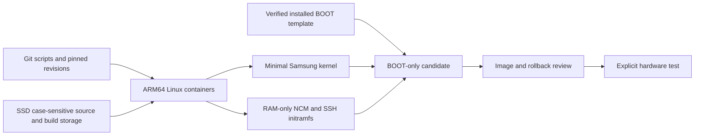

# Architecture

## Host and build boundary

Apple M4 macOS -> Docker ARM64 Linux -> pinned Samsung kernel source -> ignored build outputs. A Debian container provides clang/LLVM, host build tools and packaging dependencies. Source/configuration/provenance live in Git; upstream checkouts, images and logs stay outside tracked content. The case-sensitive SSD source tree is mounted read-only; configuration and build outputs use separate writable directories on the same SSD build image. The macOS source checkout has filename case collisions and serves only as a Git-object seed, never as the compiler input.

The running ROM used Android clang r563880c / LLVM 21. The initial native ARM64 builder uses Debian LLVM 19 to test compatibility without x86 emulation. This is source/configuration reproduction with a different compiler, not a byte-identical ROM reproduction. Compiler incompatibilities must be documented rather than silently changing the kernel.

## Device boot boundary

Existing Samsung signed firmware/bootloader -> unlocked OS-image policy -> Android boot header v2 with kernel, ramdisk and device trees -> Linux initramfs. Keep the existing bootloader and recovery route. Known release packaging includes patched top-level vbmeta; recovery has its own AVB footer. DTBO, AVB flags, partition sizes and rollback policy are independent constraints.

The first native experiment should target a small initramfs and USB NCM/SSH. Do not depend on decrypted Android userdata. Do not assume A/B slots, fastboot temporary boot, or firmware support for external boot media.

## Desktop boundary

Display/KMS, input and GPU acceleration are separate subsystems. The downstream msm_drm display nodes and Adreno KGSL interface are present under Android; a DRM render node alone does not establish Mesa support. Prove a small compositor before Hyprland/Omarchy integration.

## Evidence and recovery

Build success, image structural validity and real-device functionality are separate milestones. Every output should record source revision, configuration hash, compiler, build command and artifact hashes. Native hardware support is marked complete only after testing. Installed recovery, Download Mode policy state and restoration artifacts must be established before any partition experiment.

## Current artifact flow

The initramfs uses a RAM log, USB-local DHCP and key-only SSH. No Android filesystem is mounted. Kernel 4.14 compatibility with a future complete Arch/systemd/Omarchy stack remains a separate gate; the minimal experiment does not establish it.
